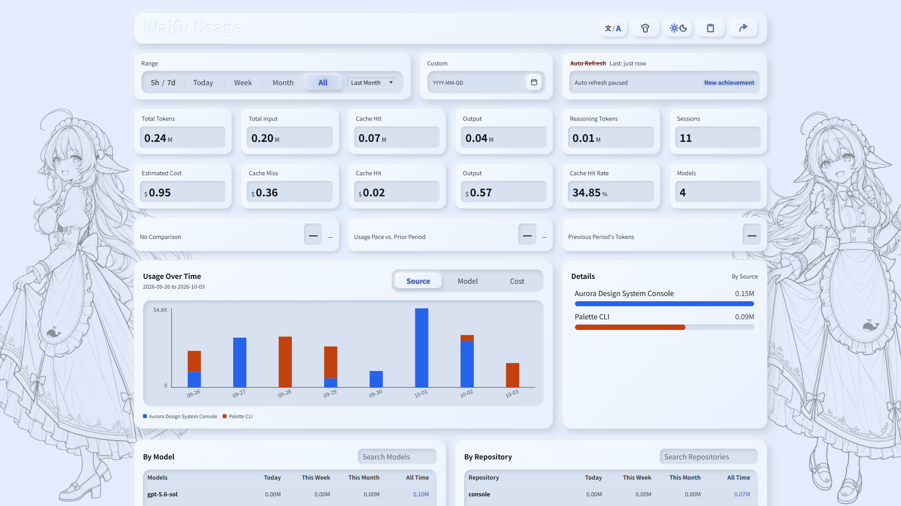
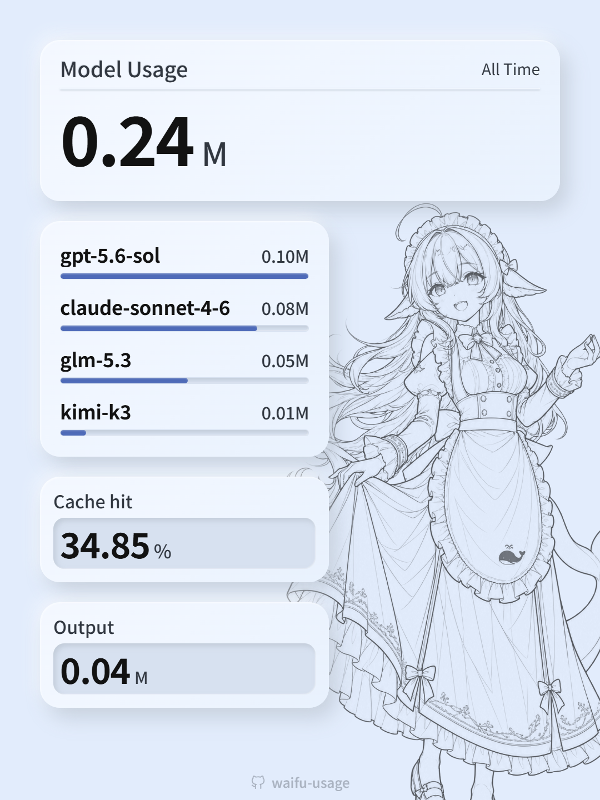

# Waifu Agent Usage

[简体中文](README.md) · English

Bring usage from your AI coding tools into one local dashboard. See where your tokens go, follow usage trends, and make it your own with character skins, share cards, and achievements.



## Let your agent install it

```text
Please install and start Waifu Agent Usage on my computer:
https://github.com/Sylva1027/waifu-agent-usage

1. Ask whether I want the full Waifu experience or Lite for focused usage tracking, then download the matching runtime ZIP from the latest stable Release.
2. Check that Node.js meets engines.node in the package's package.json. If installation is needed, get it from https://nodejs.org/.
3. Extract the package to a permanent folder. If an installation already exists, follow the repository's upgrade guide to preserve usage data, source settings, and achievement profiles before updating program files.
4. Run node src/cli.js run from the package root. No npm install or compilation is needed.
5. Tell me the dashboard URL, installation folder, and how to start and stop it later.
```

## Manual installation

Install [Node.js](https://nodejs.org/en/download) 23.8 or newer, download a [Windows x64 package below](#download), and extract it. Open a terminal in that folder and run:

```bash
node src/cli.js run
```

Open [http://127.0.0.1:3765/](http://127.0.0.1:3765/) and use source management to scan and import your logs. No `npm install` or compilation is needed; press `Ctrl+C` to stop the server.

## Features

**Usage at a glance.** Track input, output, reasoning, cached input, and cache hit rate. Search and explore details by model or repository to see where your tokens go.

**Trends and quota windows.** Explore daily, weekly, monthly, or custom ranges and compare them with the previous period. See usage within the current and previous Codex 5-hour and weekly quota windows.

**Cost estimates.** Estimate usage costs at model API rates in USD or CNY. Prices and exchange rates update automatically and can also be adjusted manually.

**Characters and themes.** Choose from ten character skins with light and dark palettes, plus visibility and opacity controls. The interface supports English and Chinese.

**Share cards.** Turn your usage into a 3:4 portrait or 4:3 landscape image. Pick the metrics and charts, then copy or save it with one click.

**Achievement badges.** Mark your milestones with 42 achievements: follow your progress, collect badges, and look back at when you earned them. See the [achievement guide](docs/achievements.en.md).

**Sources and history.** Scan local logs or import another directory, refresh automatically, or pause the current view. Back up, import, and restore history to keep your records over time and move them between machines.



## Download

| Edition | What to expect | Download |
| --- | --- | --- |
| **Waifu** | The full experience, including cost estimates, character skins, sharing, and achievements. | [Download Waifu](https://github.com/Sylva1027/waifu-agent-usage/releases/download/v1.0/1.0-waifu.zip) |
| **Lite** | Focused usage tracking and trends in a simple dark interface, with history management. | [Download Lite](https://github.com/Sylva1027/waifu-agent-usage/releases/download/v1.0/1.0-lite.zip) |

[All releases](https://github.com/Sylva1027/waifu-agent-usage/releases) · [Getting started](docs/01-getting-started.md) · [Data sources](docs/10-data-sources.md) · [Backup and transfer](docs/history-retention.md) · [Upgrading](docs/15-delivery-upgrade.md) · [Development](docs/03-development.md)

## Credits and license

Built on [DhWU-coder/codex-usage](https://github.com/DhWU-coder/codex-usage). Some character artwork is by [ZipZipPipe](https://space.bilibili.com/4168597). Thank you for the artwork.

Licensed under the [MIT License](LICENSE).
