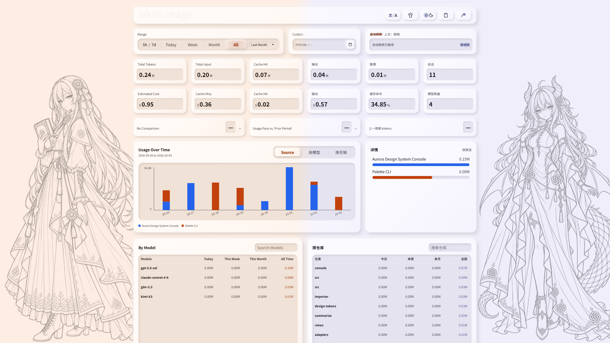
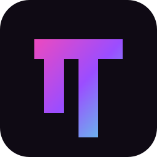
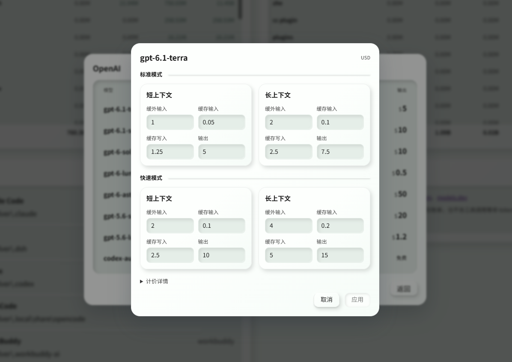
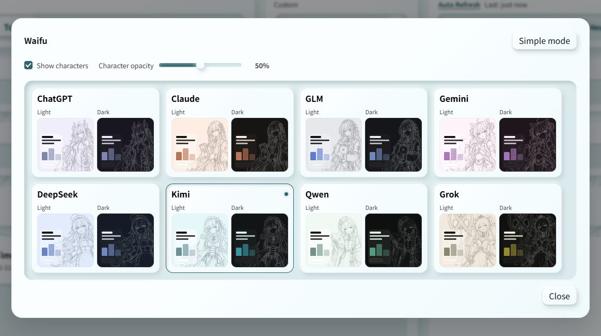
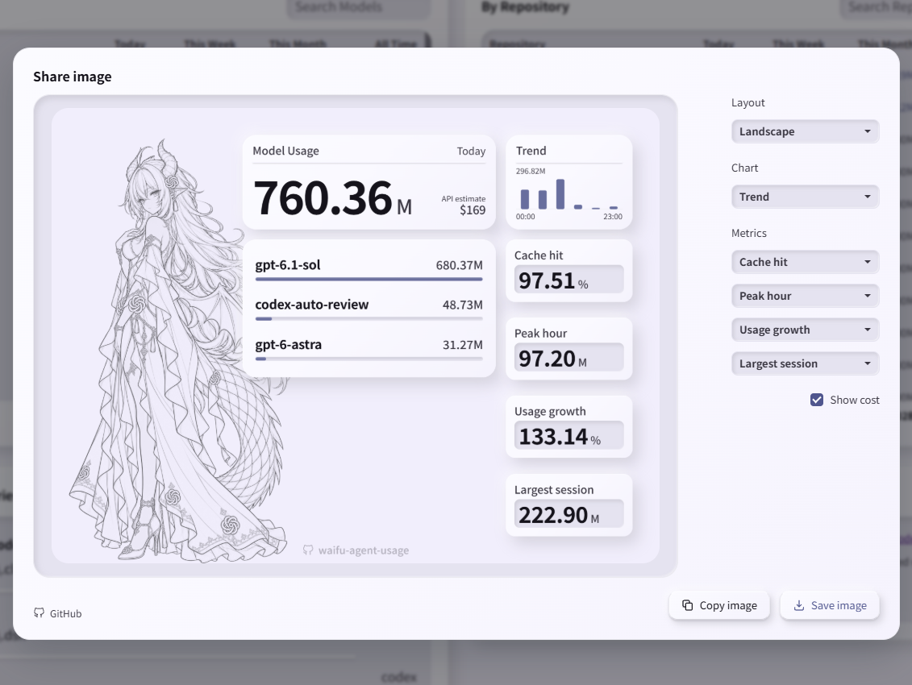
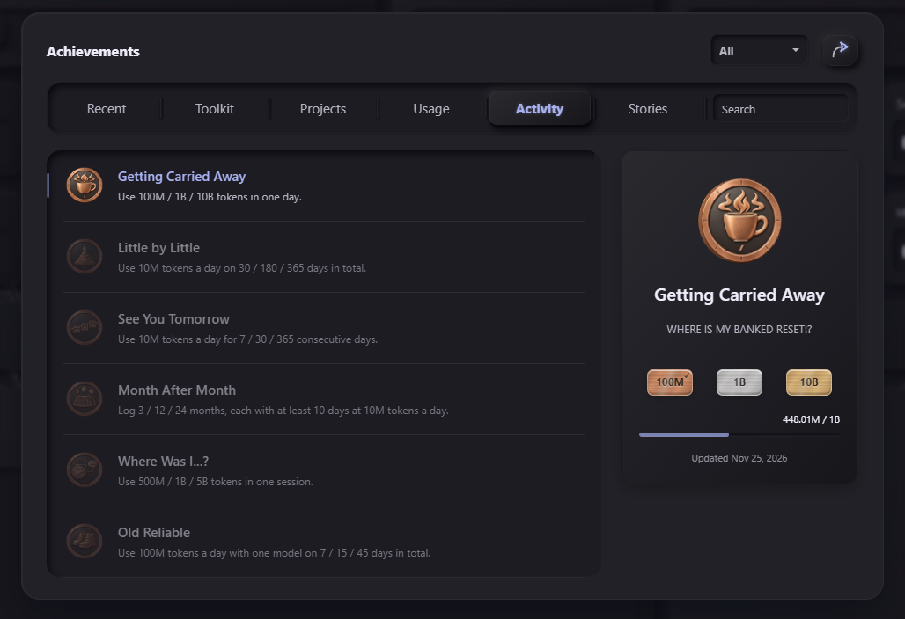
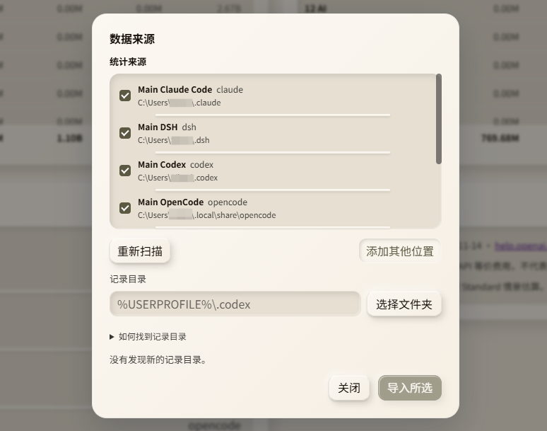
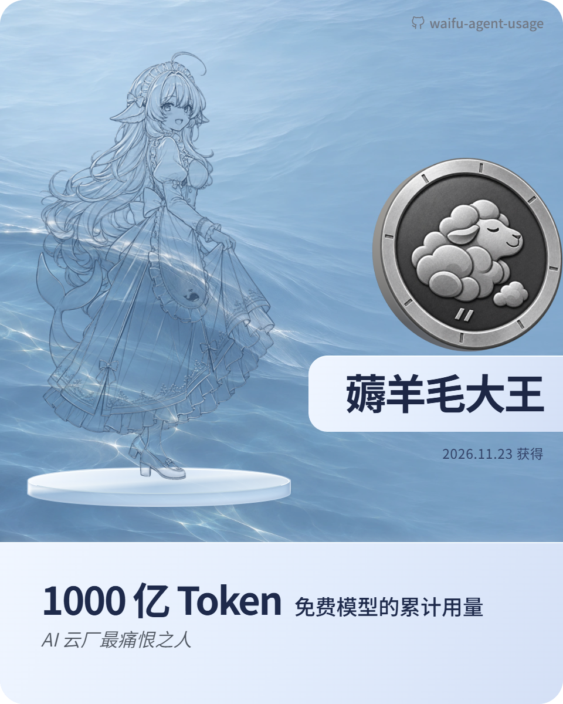
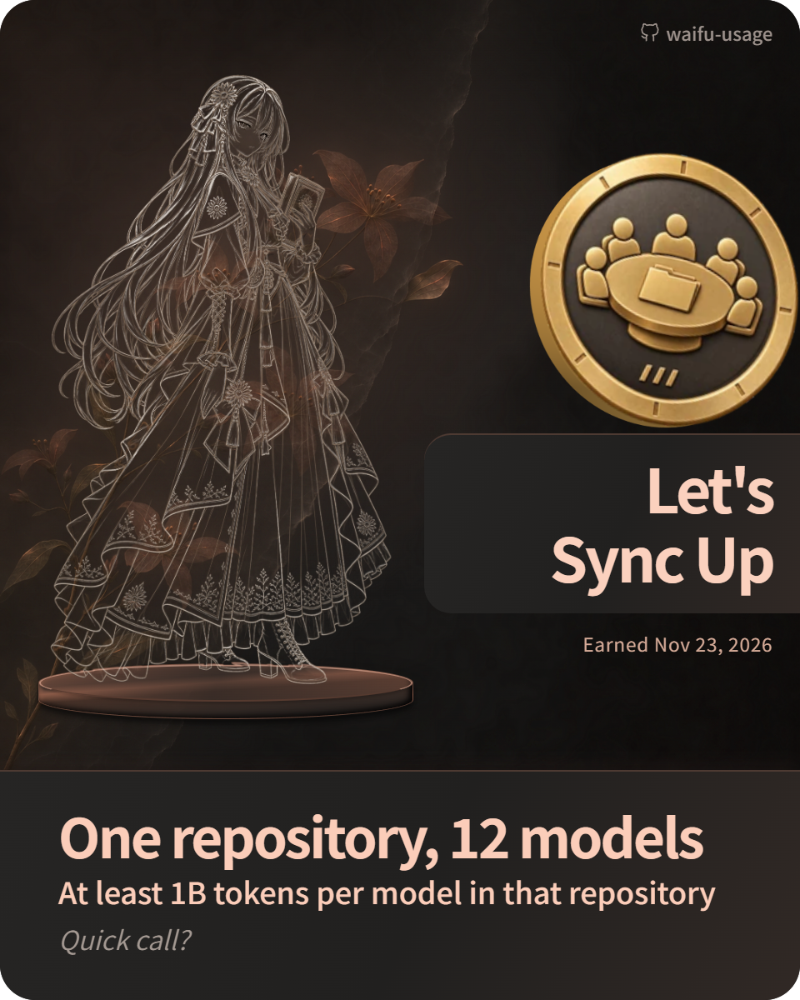

# Waifu Agent Usage

简体中文 · [English](README.en.md)

Waifu Agent Usage 是由 Sylva1027 独立维护的本地 AI 编程用量看板。汇总多个 AI 编程工具的用量，看清 Token 消耗、模型分布和使用趋势；通过角色皮肤、分享卡片与成就，让每天的使用记录也能有自己的风格。



## 支持的 Harness

<p>
  <a href="docs/data-sources/codex.md">&nbsp;Codex</a> &nbsp;&nbsp;·&nbsp;&nbsp;
  <a href="docs/data-sources/claude-code.md">&nbsp;Claude&nbsp;Code</a><br>
  <a href="docs/data-sources/opencode.md">&nbsp;OpenCode</a> &nbsp;&nbsp;·&nbsp;&nbsp;
  <a href="docs/data-sources/zcode.md">&nbsp;ZCode</a><br>
  <a href="docs/data-sources/dsh.md">&nbsp;DSH</a> &nbsp;&nbsp;·&nbsp;&nbsp;
  <a href="docs/data-sources/workbuddy.md">&nbsp;WorkBuddy</a><br>
  <a href="docs/data-sources/hermes.md">&nbsp;Hermes</a> &nbsp;&nbsp;·&nbsp;&nbsp;
  <a href="docs/data-sources/omp.md">&nbsp;Oh&nbsp;My&nbsp;Pi</a>
</p>

计划适配 [Google Antigravity](https://antigravity.google/)。

## 下载

- [**Waifu 完整版**](https://github.com/Sylva1027/waifu-agent-usage/releases/download/v1.0a/1.0a-waifu.zip) · 包含费用估算、角色皮肤、分享与成就。
- [**Lite 轻量版**](https://github.com/Sylva1027/waifu-agent-usage/releases/download/v1.0a/1.0a-lite.zip) · 专注用量统计与趋势，简洁的深色界面，保留历史管理。

[查看所有版本](https://github.com/Sylva1027/waifu-agent-usage/releases)

### 手动安装

准备好 [Node.js](https://nodejs.org/en/download) 23.8 或更高版本，下载所选版本，解压后在目录中打开终端。两版均已在 Windows x64、Ubuntu 24.04 x64 和 macOS 15（Apple Silicon）上验收。

```bash
node src/cli.js dashboard
```

命令在后台启动服务并打开浏览器。在来源管理中扫描并导入日志。运行包无需 `npm install` 或编译，用 `node src/cli.js stop` 停止服务。 [开始使用](docs/01-getting-started.md)

Waifu 和 Lite 都可以用 PowerShell 7 创建桌面快捷方式，之后双击即可打开看板。[查看创建步骤](docs/01-getting-started.md#windows-桌面快捷方式)

<details>
<summary>让 Agent 帮你安装</summary>

```text
请在我的电脑上安装并启动 Waifu Agent Usage：
https://github.com/Sylva1027/waifu-agent-usage

1. 询问我想要完整体验的 Waifu，还是专注用量统计的 Lite。
   从 Releases 下载所选版本的最新正式 ZIP 运行包。
2. 检查 Node.js 是否满足 package.json 中的 engines.node 要求。
   需要安装时，从 https://nodejs.org/ 获取。
3. 将程序放到固定目录。
   如果已有安装，先按仓库升级文档保留用量数据、来源配置和成就档案，再更新程序文件。
4. 在安装目录运行 node src/cli.js dashboard。
   使用 Lite 源码时，运行 node src/cli-lite.js dashboard。
5. 在 Windows 上，按 docs/01-getting-started.md 的说明，用 PowerShell 7
   在本机创建所选版本的桌面快捷方式。双击确认打开的是该版本的看板，
   再告诉我安装目录、快捷方式名称、实际访问地址和停止方法。
```

</details>

## 功能一览

- **用量统计。** 查看输入、输出、推理、缓存读取与命中率，按模型或仓库搜索和查看明细，了解 Token 都花在哪里。
- **趋势与额度。** 按日、周、月或自定义日期查看趋势，与上一周期比较。支持查看 Codex 当前和上一轮 5 小时／每周额度窗口内的用量。
- **费用估算。** 按模型 API 单价估算用量对应的费用，以美元或人民币查看。价目与汇率自动更新，也可手动调整。
- **角色与主题。** 八款角色皮肤搭配深浅配色，可调整角色显示与透明度，选择自己喜欢的看板风格。界面支持中英文。
- **分享卡片。** 将当前用量生成 3:4 竖版或 4:3 横版图片，自选指标与图形，一键复制或保存。
- **成就徽章。** 42 项成就记录你的使用里程碑，查看进度、收集徽章，回顾每次达成的日期。详见[成就说明](docs/achievements.md)。
- **来源与历史。** 扫描本机日志或导入其他目录，自动刷新，也可暂停当前视图。支持历史备份、导入与恢复，方便长期保留和转移使用记录。

<details>
<summary>看板功能截图</summary>







</details>

<details>
<summary>成就分享卡预览</summary>

<p align="center">
  <a href="docs/images/achievement-share-deepseek-light.png"></a>
  <a href="docs/images/achievement-share-claude-dark-en.png"></a>
</p>

</details>

## 文档

[使用指南](docs/01-getting-started.md) · [数据来源](docs/10-data-sources.md) · [备份与转移](docs/history-retention.md) · [升级说明](docs/15-delivery-upgrade.md) · [开发文档](docs/03-development.md) · [文档索引](docs/00-index.md)

## 致谢与许可

本项目最初基于 [Codex Usage](https://github.com/DhWU-coder/codex-usage)，此后围绕多 Agent 数据接入、统计架构、历史保留和个性化体验持续独立开发。感谢原作者提供的基础。

部分角色形象来自 [ZipZipPipe](https://space.bilibili.com/4168597)，感谢其创作。项目来源、贡献与素材署名见 [CREDITS.md](CREDITS.md)。

项目代码采用 [MIT License](LICENSE)，保留原作者及本项目贡献的版权声明。
