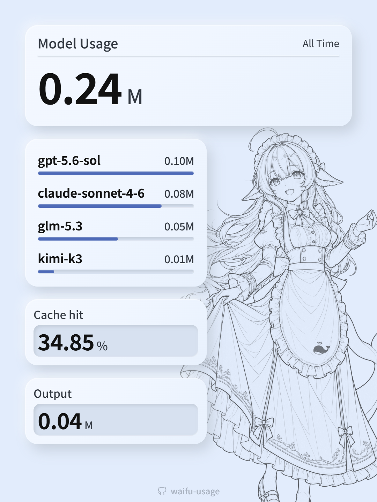

# Using the dashboard

[简体中文](12-dashboard.md) · English

Waifu and Lite share source management, date ranges, Codex quotas, usage trends, model/repository details, language, refresh, and frozen views. Waifu also offers costs, records, themes, characters, sharing, and achievements; Lite uses six usage cards and a simple dark interface.

## Time ranges and quotas

Today, Week, Month, All, and custom dates use the **server machine's local timezone**, even if the browser is elsewhere. Week is a calendar week; Last Month and Last Year cover complete calendar periods; This Year runs from January 1 to the present.

Select a start and then an end in the date control. Reverse selection, clearing, and `Escape` are supported. Longer ranges automatically combine time buckets; hover details show the dates actually covered.

`5h / 7d` selects the current Codex five-hour or weekly quota window; “Last 5h” and “Last 7d” use the previous actual quota cycle. These are not rolling five hours or a calendar week. Without a trustworthy boundary the window is unavailable; reset times are not guessed.

Quota ranges include eligible Codex subscription usage and exclude explicit API and external sources and identifiable paid credits top-ups. Free `codex-auto-review` usage remains included. When historical authentication/routing evidence is missing, known models provide a fallback estimate. Ordinary date ranges retain all selected sources. Raw Codex quota percentages are not recalculated from the filtered tokens.

Quota ranges show comparison with the previous cycle, relative usage pace, and previous-cycle tokens. An unavailable baseline shows `—`; confirmed zero usage shows `0`.

Optional account quota boundary recovery

By default only local quota records are read. To fill missing or expired boundaries, set `recoveryEnabled: true` in `~/.codex-usage/codex-quota.json` to read account quota through the official Codex app-server. Recovery is not triggered for valid boundaries, frozen snapshots, or imported data; failures retry no sooner than five minutes later. Credentials are managed by the official client, and local usage is not uploaded.

## Usage, trends, and details

Input, output, cache, and reasoning follow the [shared accounting rules](10-data-sources.en.md#token-details). Missing details are displayed separately from zeroes.

The time chart can show channels or models. Model bars are stacked by usage per time slot; hover or use keyboard focus for details. Waifu also offers a cost view; mixed currencies are converted using the selected rate while details retain original currencies.

Model and repository tables support search, sorting, expanded details, and period comparisons. Git repositories appear before ordinary directories. By default, sorting uses Today, This Week, This Month, then All; click a heading to change direction or restore the default. Waifu can mark a New Record for applicable periods; All has no preceding period.

Source management controls included directories. Ordinary ranges group by tool; quota ranges retain detailed Codex channels. See [sources and channels](10-data-sources.en.md#channel-grouping). Waifu's pricing dialog lists historically used models by provider; see [pricing](11-pricing.en.md).

## Auto-refresh and pause

By default the app checks sources every 60 seconds, syncing and updating the dashboard when changes appear. Pausing auto-refresh freezes the usage snapshot; changing ranges continues to query that snapshot. Resume to follow live usage again.

“Last” is the most recent successful check confirming current data. Filtering or querying frozen data does not label old data as newly refreshed. Runtime status reports checking, syncing, computation, and completion; on failure open the error details, then go back or press `Escape`. Auto-refresh retries in a later cycle.

Waifu's price updates run independently of usage refresh. Price edits take effect only after saving; Cancel writes nothing. Achievement notices also appear at the right of the refresh panel; see [achievements](achievements.en.md).

## Language and characters

The first language follows the browser. Use “文 / A” to switch Chinese and English; the selection is remembered. Fonts use local fonts and system fallbacks.

Waifu offers light and dark themes. The clothing icon opens the style selector for eight characters or simple mode; character visibility, opacity, and selection are saved in the local browser. Lite is fixed dark and retains Waifu preferences for a later return. Theme transitions respect the system reduced-motion setting. See [character skins](13-skins.en.md).

## Share images in Waifu

Use the share button to create a **3:4 portrait** or **4:3 landscape** PNG for the selected range. Select metrics, charts, and model display, then copy or save it. Portrait is the initial default; each orientation remembers its own metrics.

Twelve time ranges are supported, and metrics are offered according to available data. Comparison metrics are hidden without a previous period; inapplicable daily average, active days, and daily peak metrics are hidden for single-day and 5h ranges. “Show cost” initially defaults off and is remembered thereafter. Changing metrics redraws the fixed data without rescanning sources.

History backup and transfer use the [CLI history tools](history-retention.en.md) and are separate from share images.
