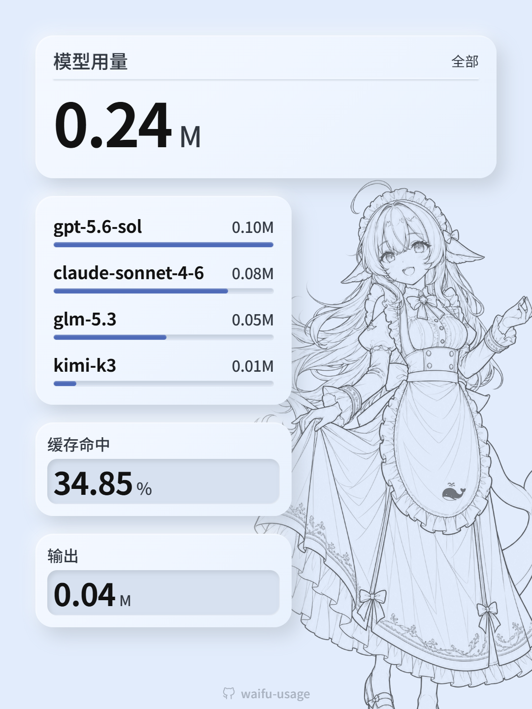

# 看板使用

简体中文 · [English](12-dashboard.en.md)

Waifu 与 Lite 共用来源管理、日期范围、Codex 额度、用量趋势、模型／仓库明细、语言、刷新和冻结。Waifu 另提供费用、纪录、主题、角色、分享与成就；Lite 使用六张用量卡和简洁的深色界面。

## 时间范围与额度

今日、本周、本月、全部和自定义日期按**服务机器的本地时区**解释。本周为自然周，上个月和去年为完整自然月／年，本年从 1 月 1 日至当前时间。浏览器在其他时区时仍以服务日历为准。

日期控件先选起点再选终点，支持反向点选、清除和 `Escape`。较长范围自动合并时间桶，悬浮详情显示实际覆盖日期。

`5h / 7d` 切换 Codex 当前五小时／每周额度窗口；“上一个5h”和“上一个7d”使用上一轮真实额度周期。它们不等于从现在向前平移五小时或普通日历周。没有可信边界时显示不可用，不猜测重置时间。

额度范围只统计符合条件的 Codex 套餐候选用量，排除明确 API、外部来源及可识别的付费 credits 补量；免费 `codex-auto-review` 用量仍保留。缺少历史认证／路由证据时使用已知模型兜底估算。普通日期范围保留全部选中来源，Codex 原始额度百分比不按筛选结果重算。

额度范围提供“较上一轮”“同比流速”和“上一轮 Tokens”三项趋势。缺少有效基准显示 `—`，确认零用量显示 `0`。

可选的账户额度边界补齐

默认只读本机额度记录。需要补齐缺失或过期边界时，可在 `~/.codex-usage/codex-quota.json` 中设置 `recoveryEnabled: true`，通过官方 Codex app-server 读取账户额度。已有有效边界、冻结快照和导入数据不触发补齐；失败后至少五分钟再试。凭据由官方客户端管理，不上传本机用量。

## 用量、趋势与明细

输入、输出、缓存和推理采用[统一统计口径](10-data-sources.md#token-明细)。缺失明细与零值分开显示。

时间图可按渠道或模型查看。模型柱按各时间槽的用量堆叠，悬浮或键盘定位可查看明细；Waifu 另可按花销查看，混币比较按所选汇率折算，详情保留原币种。

模型与仓库表支持搜索、排序、展开详情和周期比较。仓库表优先展示 Git 仓库，普通目录在后；默认按今日、本周、本月、全部用量依次排序，点击表头可切换排序方向及恢复默认。Waifu 的适用周期可显示 New Record，全部范围没有上一周期。

来源管理控制哪些目录参与统计，普通范围按工具归组，额度范围保留 Codex 细分渠道，详见[来源与渠道](10-data-sources.md#渠道展示与归组)。Waifu 的计价窗口按厂商展示全历史使用过的模型，见[计价说明](11-pricing.md)。

## 自动刷新与暂停

默认每 60 秒检查来源变化，有更新时同步并更新看板。暂停自动刷新后固定当前用量快照，切换范围仍查询这份数据；恢复后继续跟进实时用量。

“上次”表示最近成功检查并确认当前数据的时间。筛选或查询冻结数据不会把旧数据标为刚刚刷新。运行状态显示检查、同步、计算与完成情况；失败时点击“异常 · 详情”查看错误，再返回或按 `Escape`。自动刷新开启时会在后续周期重试。

Waifu 的价格自动更新独立于用量刷新。价格编辑只在保存后生效，取消不写入。成就提示也位于刷新框右侧，详见[成就说明](achievements.md)。

## 语言与角色

首次语言跟随浏览器，使用“文 / A”切换中英文，之后记住选择。字体使用本机字体和系统回退。

Waifu 提供深浅主题，衣服图标打开“界面风格”，选择八款角色或简洁模式；角色显示、透明度和选择均保存在本机浏览器。Lite 固定深色，保留已有 Waifu 偏好供切回使用。主题切换遵循系统减少动态效果的设置。详见[角色皮肤](13-skins.md)。

## 分享图片（Waifu）

点击分享按钮，将选定范围的用量生成 **3:4 竖版**或 **4:3 横版**图片。可选择指标、图形与模型展示，然后复制或保存 PNG。首次默认竖版；两种幅面的指标分别记忆。

分享支持十二项时间范围，候选指标按数据可用性显示：没有上期记录时隐藏比较指标，单日和 5h 范围隐藏不适用的日均、活跃天数及单日峰值。“显示费用”首次默认关闭，浏览器记住之后的选择。调整指标只重绘当前固定数据，不重新扫描来源。

历史备份与转移使用 [CLI 历史工具](history-retention.md)，与分享图片分别保存。
