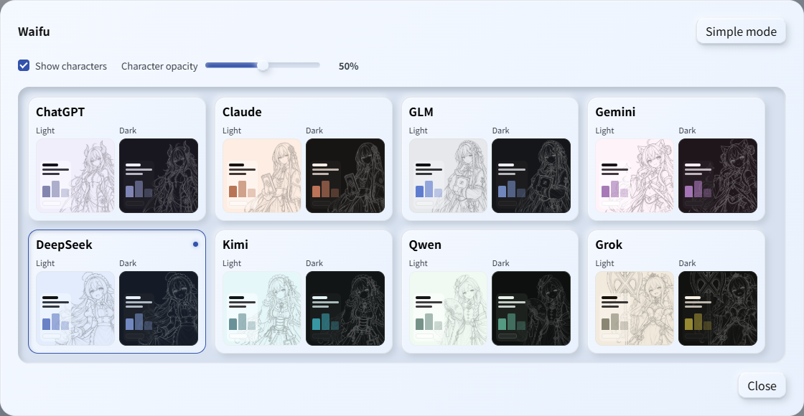

# Character skins and palettes

[简体中文](13-skins.md) · English

Character skins are available in **Waifu**. Some character artwork is by [ZipZipPipe](https://space.bilibili.com/4168597); thank you for the artwork.

## Select and configure

Use the clothing icon to open “Waifu” and choose ChatGPT, Claude, GLM, Gemini, DeepSeek, Kimi, Qwen, Grok, or simple mode.

Each skin supports light and dark themes. Toggle characters and set opacity from 0–100%, with 50% as the default. Preferences are saved in the local browser and reused on reopening; simple mode retains character visibility and opacity settings too.



Lite uses a fixed dark interface and does not display characters or the studio; existing Waifu preferences are retained for a return to Waifu.

## Palette studio

Open `/skin-palette-studio.html` in the Waifu service to preview palettes independently. Source maintenance uses:

- [public/skin-palettes.js](../public/skin-palettes.js): hand-authored palette source.
- [public/skins.js](../public/skins.js): character registry, assets, and placement.
- [public/skin-palette-studio.html](../public/skin-palette-studio.html): palette studio.
- [public/assets/skins/](../public/assets/skins/): 32 runtime WebP images.
- [scripts/prepare-skin-assets.mjs](../scripts/prepare-skin-assets.mjs): asset generation and checks.

`public/skin-bootstrap.js` and `public/skin-assets.json` are generated; do not manually maintain a second palette or digest set. Authoring PNGs are optional local inputs and are not distributed with the public repository or packages. Existing WebPs do not require the original images.

## Changes and checks

On Windows, run these read-only checks in PowerShell 7 from the repository root:

```powershell
npm.cmd run skins:palette
npm.cmd run skins:check
npm.cmd run skins:check:sources
```

`skins:check` verifies release assets; `skins:check:sources` additionally checks authoring PNGs and reports a skip when they are absent.

After changing a palette or deliberately regenerating assets, run the following in order. Prepare the required authoring images before regeneration:

```powershell
npm.cmd run skins:palette
npm.cmd run skins:prepare
npm.cmd run skins:check:sources
```

Check light and dark themes, initial display and reload, character toggle and opacity, keyboard focus, and reduced-motion behavior. Keep text readable and preserve character placement and layout without displacing controls. See [development](03-development.en.md) for the environment and browser configuration.
