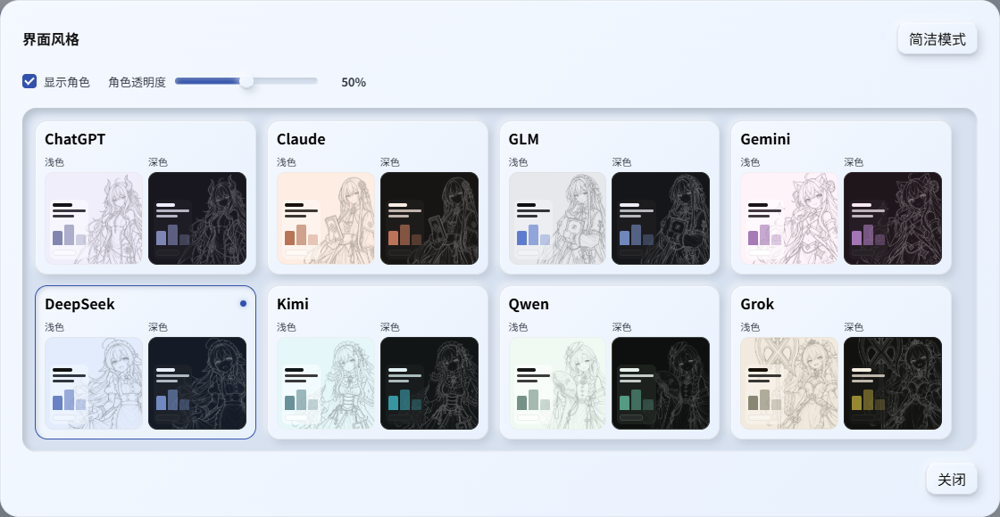

# 角色皮肤与配色

简体中文 · [English](13-skins.en.md)

角色皮肤由 **Waifu** 提供。部分角色形象来自 [ZipZipPipe](https://space.bilibili.com/4168597)，感谢其创作。

## 选择与设置

点击衣服图标打开“界面风格”（英文 Waifu），可选择 ChatGPT、Claude、GLM、Gemini、DeepSeek、Kimi、Qwen、Grok 八款角色，或使用简洁模式。

每款支持浅色和深色主题，可开关角色并调整 0–100% 透明度，默认透明度为 50%。设置保存在本机浏览器，重新打开页面继续使用；简洁模式也保留角色开关与透明度选择。



[English preview](images/skin-picker-en.png)。Lite 使用固定深色界面，不显示角色或工作室；已有 Waifu 偏好保留供切回使用。

## 配色工作室

在 Waifu 服务中打开 `/skin-palette-studio.html` 可独立预览配色。源码维护使用下列资源：

- [public/skin-palettes.js](../public/skin-palettes.js)：手写配色来源。
- [public/skins.js](../public/skins.js)：角色注册、资源和显示位置。
- [public/skin-palette-studio.html](../public/skin-palette-studio.html)：配色工作室。
- [public/assets/skins/](../public/assets/skins/)：32 张运行用 WebP。
- [scripts/prepare-skin-assets.mjs](../scripts/prepare-skin-assets.mjs)：生成与检查资源。

`public/skin-bootstrap.js` 和 `public/skin-assets.json` 为生成物，不手动维护第二套配色或摘要。作者 PNG 为可选本地输入，不随公开仓库或运行包分发；使用现有 WebP 无需这些源图。

## 修改与检查

Windows 使用 PowerShell 7，在仓库根目录运行只读检查：

```powershell
npm.cmd run skins:palette
npm.cmd run skins:check
npm.cmd run skins:check:sources
```

`skins:check` 验证发布资源；`skins:check:sources` 额外检查作者 PNG，缺少时报告跳过。

修改配色或有意重生成资源后，按以下顺序执行；重生成所需的作者源图须事先准备好：

```powershell
npm.cmd run skins:palette
npm.cmd run skins:prepare
npm.cmd run skins:check:sources
```

检查深浅主题、首屏与重载、角色开关和透明度、键盘焦点及减少动态效果。保持文字可读、人物位置和既有布局，角色不挤占功能区。开发环境和浏览器配置见[开发指南](03-development.md)。
